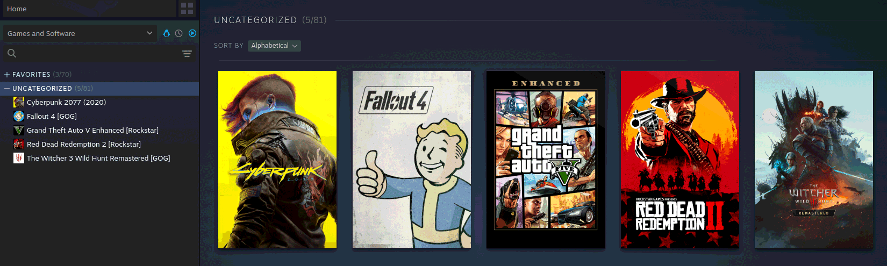

# Steam Adopt

A command-line tool that adopts your non-Steam games into Steam, with cover art, icons, launch options and, on Linux and the Steam Deck, Proton set up for you.

  
  
  
  

  

## Features

- Every game folder becomes a non-Steam game in your Steam library.
- Cover, banner, hero, logo and icon downloaded from the Steam store.
- On Linux, Proton set for Windows games, using Steam's default or a version of your choice.
- Changes made inside Steam are kept, and Steam's files are backed up before every write.
- Renamed or moved game folders keep their shortcut, so Proton saves and playtime stay.
- Works on Linux (native and Flatpak Steam), the Steam Deck, Windows and macOS, as a single binary with nothing to install.

## Installation

1. Download the archive for your system from the [latest release](https://github.com/ddrimus/steam-adopt/releases/latest):
   - Linux and Steam Deck: `steam-adopt-<version>-linux-amd64.tar.gz`
   - Windows: `steam-adopt-<version>-windows-amd64.zip`
   - macOS: `steam-adopt-<version>-darwin-amd64.tar.gz`
2. Extract it.
3. Put `steam-adopt` somewhere on your PATH, like `~/.local/bin` on Linux.

The binaries aren't signed. On macOS, allow it once with `xattr -d com.apple.quarantine steam-adopt`. On Windows, SmartScreen may warn on the first run: choose **More info**, then **Run anyway**.

## Usage

1. Log in to Steam at least once.
2. Put each game in its own folder inside your games folder. It's `~/.local/share/games` on Linux and `~/Games` on Windows and macOS by default, but it can be anywhere, using `--games` or `STEAM_ADOPT_GAMES`. Tags like `[GOG]` or `(2019)` in a folder name are ignored.
3. Run `steam-adopt -n` to see what would change, then `steam-adopt` to do it.

Run it again after adding, changing or deleting a game folder, and Steam is updated to match. Steam is closed only when needed, and started again afterwards.

- `-n`, `--dry-run`: Show what would change without touching anything.
- `-y`, `--yes`: Remove skipped and deleted games from Steam without asking.
- `--games DIR`: Use another games folder, also settable with `STEAM_ADOPT_GAMES`.

Each game gets one line: `+` added, `~` updated, `=` up to date, `-` skipped or removed and `?` no executable found (set `exe` in its section). Lines starting with `!` need your attention.

Removing a game from Steam can lose the saves in its Proton prefix, so steam-adopt asks first unless `--yes` is given.

With Flatpak Steam, the games folder has to be shared with its sandbox, and steam-adopt shows the `flatpak override` command to run.

## Steam Deck

- Run steam-adopt in **Desktop Mode**, from Konsole. In Game Mode, Steam starts again as soon as it's closed, so steam-adopt refuses to change anything there.
- For games on the SD card, use `steam-adopt --games /run/media/deck/<card name>/Games`, or set `STEAM_ADOPT_GAMES`. While the card is out, nothing is removed from Steam.

## Windows and macOS

Games run as they are, without Proton. On macOS a game is its `.app`, and Windows builds are left out. On Windows, linking the artwork into Steam needs **Developer Mode** (**Settings** → **System** → **For developers**), or steam-adopt run as administrator.

## Configuration

The first run creates `_steam-adopt/steam-adopt.conf` inside the games folder. `[settings]` applies to every game, and each game folder gets its own section showing the picked values, commented out. Remove the `#` in front of a line to change it.

In `[settings]` or a game's section:

- `launch_options`: Steam launch options, like `gamemoderun mangohud %command%`.
- `proton` (Linux only): `auto` for Steam's default, a version like `GE-Proton10-1`, or `none`.
- `artwork`: `no` leaves the artwork alone.

Only in a game's section:

- `skip`: Leave the game out, removing it from Steam if it was already added.
- `name`, `exe`, `steam_id`: The name shown in Steam, the file to launch (inside the game folder), and the store ID used for artwork, as a number or the store page URL.

Only in `[settings]`:

- `restart_steam`, `start_steam`: Start Steam after a sync when steam-adopt closed it, or always.

To use your own artwork, put `cover.jpg`, `banner.jpg`, `hero.jpg` or `logo.png` in `_steam-adopt/artwork/<game folder>/`. Artwork set from inside Steam is kept too.

## Undoing Changes

- To take a game out of Steam, set `skip = yes` in its section and run steam-adopt again.
- Steam's `shortcuts.vdf` and `config.vdf` are backed up next to themselves as `.bak` files before each write. To go back, close Steam and copy a backup over the file.

## Contributing

If you have any improvements, additional information, or notice any issues with Steam Adopt, we'd love to hear from you! Feel free to open a pull request with your suggestions or details. Please use a [conventional commit](https://www.conventionalcommits.org/) title (`feat:`, `fix:` or `chore:`), since titles become the release notes.

If you encounter any problems with the tool or believe something isn’t working as expected, please provide all relevant information in an [issue](https://github.com/ddrimus/steam-adopt/issues), including your system and the output of `steam-adopt --dry-run`. Your contributions, suggestions, and feedback are always welcome and appreciated!
